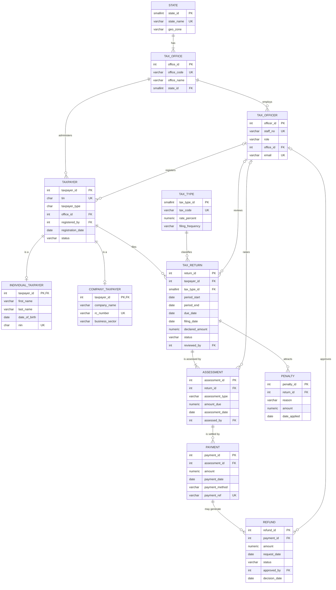

# Portfolio 1 – Database Design and Modelling

**Case study:** Nigeria Revenue Service (NRS) Tax Administration Database (simulated)
**DBMS:** PostgreSQL 16 (Docker container `nrs_postgres`, database `nrs_tax_db`, schema `nrs`)

All data is **synthetic**. No real taxpayer, company or NRS record is used.

## Files in this folder

| File | What it does |
|---|---|
| [`01_schema.sql`](01_schema.sql) | Creates the 12 tables, keys, constraints, indexes and 2 views |
| [`02_seed_data.sql`](02_seed_data.sql) | Loads synthetic data. It is repeatable because it uses a fixed random seed |
| [`03_sample_queries.sql`](03_sample_queries.sql) | Demonstrates the 7 key operations and the management reports |
| [`sample_output.txt`](sample_output.txt) | Output of `03_sample_queries.sql` |

### How to run

From the folder that contains these files, with Docker running and `docker compose up -d` already done:

```bash
docker exec -i nrs_postgres psql -U nrs_admin -d nrs_tax_db < 01_schema.sql
docker exec -i nrs_postgres psql -U nrs_admin -d nrs_tax_db < 02_seed_data.sql
docker exec -i nrs_postgres psql -U nrs_admin -d nrs_tax_db < 03_sample_queries.sql
```

To use pgAdmin instead, go to http://localhost:5050 and register a server with host `postgres`, user `nrs_admin` and database `nrs_tax_db`. Then open the files in the Query Tool. The tables are in the **`nrs`** schema.

---

## 1. Case study summary

The NRS is Nigeria's federal revenue authority. This database supports its core tax administration cycle:

```
Register taxpayer (issue TIN) → File return → Assessment → Payment
                                     │              │           │
                                     └→ Penalty     └→ Additional assessment (audit)
                                                                └→ Refund (if overpaid)
```

**Business rules captured in the design:**

1. Every taxpayer has exactly one unique 10-digit **TIN** and is managed by one **tax office**.
2. A taxpayer is either an **individual** or a **company**, never both. Each has different details: NIN and date of birth for individuals, RC number and sector for companies.
3. A taxpayer files at most **one return per tax type per period**.
4. Each return has exactly **one ORIGINAL assessment**. An auditor may later raise **ADDITIONAL** assessments.
5. Payments are made **against an assessment**. An assessment may be paid in several instalments.
6. A **refund** comes only from a payment that exceeded the amount due. Approving or paying it requires a named officer and a decision date.
7. **Penalties** attach to a return: late filing, late payment or under-declaration.
8. A taxpayer's **balance is never stored**. It is calculated from assessments, penalties, payments and refunds. See the `v_taxpayer_balance` view.

---

## 2. Entity–Relationship diagram

GitHub renders this diagram automatically. Crow's-foot notation: `||` means exactly one, `o|` means zero or one, `o{` means zero or many, and `|{` means one or many.



**Generalisation and specialisation.** `TAXPAYER` is a supertype with two subtypes, `INDIVIDUAL_TAXPAYER` and `COMPANY_TAXPAYER`. The specialisation is **disjoint**, because a taxpayer is one or the other. It is **total**, because every taxpayer must be one of them. Disjointness is enforced in the database with a composite foreign key `(taxpayer_id, taxpayer_type)` and a `CHECK` on each subtype. A company row therefore cannot point at an individual's taxpayer record.

---

## 3. Relational schema

Notation: **primary keys** are in bold, *foreign keys* are in italics with → pointing to the referenced table.

- STATE (**state_id**, state_name, geo_zone)
- TAX_OFFICE (**office_id**, office_code, office_name, *state_id*→STATE, address)
- TAX_TYPE (**tax_type_id**, tax_code, tax_name, rate_percent, filing_frequency)
- TAX_OFFICER (**officer_id**, staff_no, first_name, last_name, role, *office_id*→TAX_OFFICE, email, hire_date)
- TAXPAYER (**taxpayer_id**, tin, taxpayer_type, *office_id*→TAX_OFFICE, *registered_by*→TAX_OFFICER, registration_date, email, phone, address, status)
- INDIVIDUAL_TAXPAYER (***taxpayer_id***→TAXPAYER, first_name, last_name, date_of_birth, nin, occupation)
- COMPANY_TAXPAYER (***taxpayer_id***→TAXPAYER, company_name, rc_number, incorporation_date, business_sector)
- TAX_RETURN (**return_id**, *taxpayer_id*→TAXPAYER, *tax_type_id*→TAX_TYPE, period_start, period_end, due_date, filing_date, declared_amount, status, *reviewed_by*→TAX_OFFICER)
- ASSESSMENT (**assessment_id**, *return_id*→TAX_RETURN, assessment_type, amount_due, assessment_date, *assessed_by*→TAX_OFFICER, remarks)
- PAYMENT (**payment_id**, *assessment_id*→ASSESSMENT, amount, payment_date, payment_method, payment_ref)
- PENALTY (**penalty_id**, *return_id*→TAX_RETURN, reason, amount, date_applied)
- REFUND (**refund_id**, *payment_id*→PAYMENT, amount, request_date, status, *approved_by*→TAX_OFFICER, decision_date)

---

## 4. Keys and constraints

### Candidate, primary and surrogate keys
Each table uses a **surrogate primary key**, an auto-numbered `SERIAL` value. Natural identifiers such as a TIN can be corrected or re-issued, so they are not used as primary keys. Each natural identifier is still protected as an **alternate (candidate) key** with `UNIQUE`:

| Table | Candidate (alternate) keys |
|---|---|
| taxpayer | `tin` |
| individual_taxpayer | `nin` |
| company_taxpayer | `rc_number` |
| tax_officer | `staff_no`, `email` |
| tax_office | `office_code` |
| tax_type | `tax_code` |
| payment | `payment_ref` |
| tax_return | (`taxpayer_id`, `tax_type_id`, `period_start`), a composite key that stops duplicate filings |

### Integrity constraints used

| Type | Example in the schema | Rule enforced |
|---|---|---|
| Entity integrity | `PRIMARY KEY` on every table | Every row is identifiable and the key is never NULL |
| Referential integrity | `tax_return.taxpayer_id REFERENCES taxpayer` | A return cannot belong to a taxpayer who does not exist |
| Domain (CHECK) | `tin ~ '^[0-9]{10}$'`, `nin ~ '^[0-9]{11}$'` | Identifier formats |
| Domain (CHECK) | `role IN ('TAX_OFFICER','AUDITOR','MANAGER','ADMIN')` | Allowed values, like an enumeration |
| Domain (CHECK) | `payment.amount > 0`, `amount_due >= 0` | No negative money |
| Multi-column CHECK | `period_end > period_start`, `due_date >= period_end` | Dates in a sensible order |
| Business rule CHECK | refund: if status ≠ PENDING then `approved_by` and `decision_date` are NOT NULL | A refund is decided only by a named officer |
| Partial unique index | `UNIQUE (return_id) WHERE assessment_type = 'ORIGINAL'` | Exactly one original assessment per return |
| Subtype integrity | composite FK `(taxpayer_id, taxpayer_type)` with `CHECK (taxpayer_type = 'I')` | Disjoint specialisation |
| `ON DELETE CASCADE` | subtype → taxpayer | Deleting a taxpayer also deletes its subtype row |
| `NOT NULL` / `DEFAULT` | `status DEFAULT 'ACTIVE'`, `registration_date DEFAULT CURRENT_DATE` | Required data has sensible defaults |

Financial tables (return, assessment, payment, refund) deliberately do **not** cascade deletes. The database refuses to delete a taxpayer who has financial history, which protects the audit trail.

Some rules involve sums across rows, such as "a refund cannot exceed the overpayment" and "a payment date must be after its assessment date". A simple CHECK cannot express them. They would need triggers, which are left for Portfolio 3 (transactions).

---

## 5. Normalisation

### Functional dependencies (main ones)

- `taxpayer_id → tin, taxpayer_type, office_id, registration_date, status, …` and `tin → taxpayer_id`
- `office_id → office_code, office_name, state_id`; `state_id → state_name, geo_zone`
- `tax_type_id → tax_code, rate_percent, filing_frequency`
- `return_id → taxpayer_id, tax_type_id, period_start, period_end, due_date, filing_date, declared_amount`
- `(taxpayer_id, tax_type_id, period_start) → return_id` (candidate key)
- `assessment_id → return_id, assessment_type, amount_due, …`
- `payment_id → assessment_id, amount, payment_date, …`

### From an unnormalised form to 3NF / BCNF

A naive single "tax record" spreadsheet might look like this:

| TIN | Name | Office | State | Zone | TaxType | Rate | Period | Declared | AmountDue | Payments (date, amount, …) |
|---|---|---|---|---|---|---|---|---|---|---|

| Normal form | Problem in the naive table | Fix applied in this design |
|---|---|---|
| **1NF** | The *Payments* column holds a repeating group of several payments in one cell | Payments moved to their own `payment` table, one row per payment, so every value is atomic |
| **2NF** | With key (TIN, TaxType, Period), *Name* depends only on TIN and *Rate* depends only on TaxType. These are **partial dependencies** | Taxpayer details moved to `taxpayer`; rate and frequency moved to `tax_type` |
| **3NF** | *Office → State → Zone* is a **transitive dependency**: the zone is repeated for every taxpayer in a state | `tax_office` and `state` became separate tables |
| **BCNF** | In every table, every determinant (left side of an FD) is a candidate key, e.g. `tin` and `taxpayer_id` in `taxpayer` | Satisfied. There are no non-key determinants |
| **Derived data** | Storing a running *balance* creates an update anomaly. The balance can go out of step with payments | The balance is **calculated** in the view `v_taxpayer_balance` and never stored |

The supertype/subtype split also removes the NULLs a single table would carry. In one combined table, every individual would have an empty `rc_number` and every company an empty `date_of_birth`.

### Controlled denormalisation considered
`amount_due` in `assessment` could in theory be recalculated as `declared_amount × rate`. It is stored on purpose for two reasons. Tax rates change over time, so an assessment must keep the amount that applied when it was raised. Additional assessments are not a simple formula.

---

## 6. Synthetic data set

Generated by `02_seed_data.sql` with `setseed(0.8103)`, so it is identical on every run. The simulation date is 13 Nov 2026. The figures below are for the default size (`scale` = 1). Portfolio 2 loads the same generator at `scale` = 25.

| Table | Rows | Notes |
|---|---|---|
| state | 37 | 36 states + FCT, 6 geopolitical zones |
| tax_office | 45 | One per state, plus extra offices in Lagos, Abuja, Rivers and Kano |
| tax_type | 4 | CIT 30%, VAT 7.5%, PIT 15% (simplified flat rate), WHT 10% |
| tax_officer | 200 | 70% officers, 20% auditors, 8% managers, 2% admins |
| taxpayer | 2,000 | 1,500 individuals + 500 companies; 35% Lagos, 15% Abuja |
| tax_return | 18,396 | PIT/CIT 2023–2025, VAT/WHT monthly Jan 2025–Sep 2026; ~8% non-filers, ~20% late |
| assessment | 19,068 | 1 original per return + additional assessments for audited returns |
| payment | 19,786 | Full, instalment, partial, over-paid and unpaid cases |
| penalty | 4,388 | Late filing + under-declaration |
| refund | 377 | From over-payments; pending, approved, rejected and paid |

This volume is enough for meaningful execution plans in **Portfolio 2 (Query Optimisation)**.

---

## 7. Key operations: where to find them

All seven operations are in [`03_sample_queries.sql`](03_sample_queries.sql). Part A runs inside a transaction that is rolled back, so the data is not changed.

| # | Operation | SQL technique |
|---|---|---|
| 1 | Register taxpayer and issue TIN | Data-modifying CTE (`WITH … INSERT … RETURNING`) inserts the supertype and subtype together |
| 2 | File a tax return | `INSERT … SELECT` with look-ups by TIN and tax code |
| 3 | Generate assessment | Amount calculated from `declared_amount × rate_percent` |
| 4 | Record payment / update balance | Payment insert; the balance updates automatically through the view |
| 5 | Process refund | Overpayment minus outstanding penalties |
| 6 | Late-filing penalty | ₦25,000 + ₦5,000 per further 30 days late |
| 7 | Revenue reports | Multi-table joins + `GROUP BY` by zone/state, office and tax type |

Demo result for the new taxpayer: tax ₦1,440,000 + penalty ₦25,000, paid ₦1,500,000, refund ₦35,000, **balance ₦0.00**.
